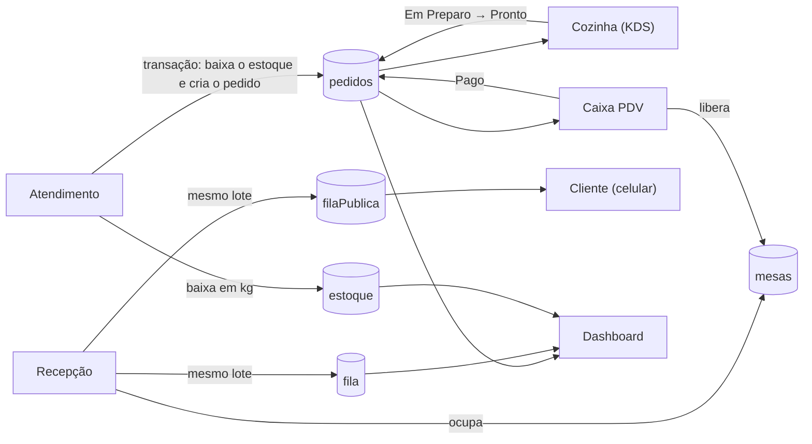

# Gaúcho Express

**Sistema de gestão de atendimento e cozinha para restaurante, em tempo real.**

Salão, cozinha, estoque, recepção e caixa trabalham sobre os mesmos dados: quando o garçom envia um pedido, a cozinha o vê na hora, o estoque é baixado automaticamente e o caixa já sabe o que cobrar, sem papel, sem redigitação e sem atualizar a tela. O cliente que espera por uma mesa acompanha a própria posição na fila pelo celular.

🔗 **Demonstração online:** <https://gaucho-express.vercel.app> (acesso restrito a usuários cadastrados; as credenciais de teste são entregues junto com o trabalho)

---

## 1. Contexto do trabalho

| | |
|---|---|
| **Empresa (fictícia)** | Gaúcho Express |
| **Ramo de atividade** | Restaurante |
| **Sistema proposto** | Gestão de atendimento e cozinha |
| **Tipo de entrega** | Trabalho acadêmico em grupo (UNINOVE) |

A proposta partiu de um levantamento de **cinco problemas reais** na operação de um restaurante que ainda funciona com papel e prancheta. O sistema foi construído para resolver cada um deles, com um módulo dedicado.

## 2. Equipe

| Integrante | Área de atuação |
|---|---|
| **Arthur Silva Monteiro** | **Desenvolvimento front-end e UI/UX**: interface de todas as telas, design system, tema claro/escuro, responsividade, animações e acessibilidade |
| Cainan Bevilaqua Rizzo | Modelagem dos dados no Firestore e regras de segurança do banco |
| João Vitor Anacleto | Regras de negócio do estoque: fichas técnicas e baixa automática de insumos |
| Matheus Leoni Melo | Levantamento de requisitos, testes de uso e validação dos fluxos entre os módulos |
| Patrick dos Santos Mauricio | Documentação, publicação (deploy) e preparação da apresentação |

Todos os cinco participaram do levantamento inicial dos problemas que originaram o projeto.

## 3. Problemas propostos e como o sistema os resolve

| # | Problema identificado | Consequência na operação | Solução no sistema |
|---|---|---|---|
| 1 | **Atendimento:** anotações em bloco de papel, ilegíveis pela pressa | Pratos com ingredientes errados e itens esquecidos | **Módulo Atendimento.** O garçom escolhe a mesa e toca nos itens do cardápio. O pedido é enviado de forma estruturada, sem letra para decifrar. |
| 2 | **Cozinha:** pedidos em papel que se misturam e perdem a ordem de chegada | Preparo fora do padrão, atrasos e mesas mais novas atendidas antes das mais antigas | **Módulo Cozinha (KDS).** Os pedidos chegam em tela, **do mais antigo para o mais novo**, com os estados *Pendente → Em Preparo → Pronto*. Mostra o tempo de espera e destaca pedidos em **atenção (10 min)** e **urgentes (20 min)**. |
| 3 | **Estoque:** vendas não dão baixa automática; compras no "achismo" | Desperdício de carnes nobres que vencem na geladeira | **Módulo Estoque.** Cada prato tem uma **ficha técnica** (quilos de cada insumo). Ao enviar o pedido, o estoque é baixado automaticamente. Há alerta de **"abaixo do mínimo"** e bloqueio de estoque negativo. |
| 4 | **Recepção:** fila em prancheta, sem previsão de espera e sem transparência para o cliente | Clientes desistem da fila | **Módulo Recepção.** Fila digital com a posição de cada grupo, **estimativa automática do tempo de espera** e fluxo *Aguardando → Chamando → Alocada*. Cada cliente recebe um **link de acompanhamento**: pelo celular, sem login, ele vê a própria posição, o tempo estimado e o aviso de quando a mesa estiver pronta, tudo atualizado em tempo real. O **mapa do salão** mostra quais mesas estão livres, e acomodar alguém só é possível numa mesa livre que comporte o grupo. |
| 5 | **Caixa:** conferência e soma manual de comandas de papel | Fila na saída e fechamento demorado, principalmente ao dividir a conta | **Módulo Caixa PDV.** Consumo da mesa somado automaticamente, taxa de serviço (10%) e **divisão da conta entre N pessoas** em um clique. Ao pagar, todos os pedidos da mesa são fechados juntos. |

Além dos cinco módulos, o **Dashboard** reúne os indicadores do restaurante (pedidos em aberto, pessoas na espera, itens no limite do estoque) e um gráfico do volume de pedidos por período. Cada funcionário enxerga apenas as telas do seu **perfil de acesso** (seção 4).

### O que ainda não faz (limites do projeto)

- O link de acompanhamento é **entregue ao cliente pela equipe** (botão "Copiar link" na recepção, para enviar por mensagem). Não há envio automático por SMS ou WhatsApp, nem QR Code.
- Os perfis e as mesas são cadastrados **manualmente no console do Firebase**; não existe tela de administração de equipe nem de salão.
- Não há junção de mesas: um grupo maior que a maior mesa (6 lugares) não pode ser acomodado pelo sistema.
- Os testes automatizados cobrem a **lógica de negócio** (seção 6). Não há testes de interface automatizados no repositório, e as regras do Firestore devem ser validadas no simulador do console antes de publicar (roteiro na seção 7).

## 4. Como o sistema funciona



Todas as telas ficam "escutando" o banco (Firestore). Quando uma pessoa altera algo em um dispositivo, as demais telas se atualizam sozinhas.

### Perfis de acesso

Cada usuário tem um documento em `usuarios/{uid}` com o campo `perfil`. O acesso é restrito **em duas camadas**: a interface esconde e bloqueia as telas, e as **regras de segurança do banco** impedem as gravações mesmo que alguém tente burlar a interface.

| Perfil | Telas | O que pode gravar no banco |
|---|---|---|
| `gerente` | Todas | Tudo o que o sistema permite, inclusive ajustes de estoque e gestão de perfis |
| `garcom` | Atendimento | Criar pedidos; só **diminuir** o estoque (a baixa do pedido) |
| `cozinha` | Cozinha (KDS) | Só avançar o pedido: *Pendente → Em Preparo → Pronto* |
| `recepcao` | Recepção | Entrada e andamento da fila |
| `caixa` | Caixa PDV | Só marcar pedidos como *Pago* |

Quem entra sem perfil válido vê a tela "Acesso ainda não liberado", com o código do usuário para o gerente cadastrar. Nenhum acesso é concedido por padrão.

### Acompanhamento da fila pelo cliente

O cliente **nunca lê a fila real**, porque ela contém os nomes de outras pessoas. Ao entrar na fila, a recepção grava dois documentos no mesmo lote (ou os dois, ou nenhum): o registro completo em `fila` e um registro **anônimo** em `filaPublica`, com apenas `status` e horário de chegada. O link do cliente (`/fila/<id>`) usa o código aleatório desse documento, e a posição é calculada contando quem chegou antes e ainda aguarda.

### Controle de mesas

O salão tem **12 mesas** (`mesas/1` a `mesas/12`), cada uma com um número de lugares: quatro de 2 lugares, seis de 4 e duas de 6. Cada mesa fica `Livre` ou `Ocupada`, e isso aparece no mapa do salão, na Recepção.

- **Acomodar alguém** só é possível numa mesa **livre** e que **comporte o grupo**: o sistema oferece apenas essas, da menor para a maior, para não gastar a mesa de 6 com um casal. Se nenhuma serve, ele diz isso em vez de deixar a recepção escolher errado.
- A mesma gravação marca a fila como `Alocada`, guarda o número da mesa, atualiza a página do cliente e ocupa a mesa. Ou tudo acontece, ou nada acontece.
- **Pagar a conta no Caixa libera a mesa** automaticamente, na mesma gravação que marca os pedidos como `Pago`.
- Como a maior mesa tem 6 lugares, a fila aceita grupos de **até 6 pessoas**: antes era possível colocar 20 pessoas numa fila que nenhuma mesa comportaria. O Atendimento, pelo mesmo motivo, aceita apenas os números de mesa de 1 a 12.

### Decisões técnicas importantes

- **Pedido e baixa de estoque na mesma transação.** Ou o pedido é criado *e* o estoque é descontado, ou nada acontece. Nunca fica estoque descontado de um pedido que não existe. Se faltar insumo, o pedido é recusado com uma mensagem clara.
- **Ajuste manual de estoque também por transação**, impedindo valores negativos mesmo com duas pessoas mexendo ao mesmo tempo.
- **Cardápio e fichas técnicas em um único arquivo** (`src/data/cardapio.js`). Atendimento e Caixa usam os mesmos dados, então preço e consumo de insumos nunca divergem entre as telas.
- **Valores monetários em centavos (números inteiros)** no Caixa, para evitar erros de arredondamento.
- **Pagamento em lote:** todos os pedidos da mesa passam para "Pago" juntos (e a mesa é liberada na mesma gravação), ou nada muda.
- **Regras de negócio em funções puras** (`src/utils`, `src/config/perfis.js`), separadas da interface, o que permite testá-las automaticamente.
- **Regras do banco no princípio do menor privilégio:** tudo é negado por padrão, e cada perfil só faz as gravações que o seu trabalho exige. Pedidos e fila nunca podem ser apagados.
- **Link público sem dados pessoais** e com validação do código recebido na URL antes de qualquer consulta ao banco.
- **Telas carregadas sob demanda** (*lazy loading*): o gráfico do Dashboard, que é pesado, só é baixado quando a tela é aberta.
- **Tratamento de falhas:** uma tela com erro não derruba o sistema (`ErrorBoundary`), e falhas de conexão ou de permissão mostram mensagens claras.
- **Acessibilidade:** navegação por teclado, link "pular para o conteúdo", rótulos para leitores de tela, respeito à preferência de reduzir animações e atenção ao contraste de cores nos temas claro e escuro.

## 5. Tecnologias

| Camada | Tecnologia |
|---|---|
| Interface | React 19, Vite, React Router |
| Banco de dados e login | Firebase: Cloud Firestore (tempo real) e Authentication |
| Animações | GSAP |
| Gráficos e ícones | ApexCharts e Lucide |
| Estilo | CSS próprio com *design tokens*, tema claro/escuro, fonte Inter, responsivo |
| Testes | Executor nativo do Node (`node:test`), sem dependências extras |
| Qualidade | oxlint |
| Hospedagem | Vercel |

**Identidade visual ("Soft Elegance"):** paleta neutra em tons de ardósia, superfícies suaves, cor de destaque em laranja-brasa e animações discretas.

## 6. Como executar e testar

```bash
cd gaucho-express
npm install
cp env.example .env       # preencha as variáveis VITE_FIREBASE_* do seu projeto Firebase
npm run dev               # desenvolvimento
npm run build             # versão de produção
npm test                  # testes automatizados
```

**Testes automatizados (75):** cobrem as regras que o restaurante não pode errar: cálculo de consumo de insumos pela ficha técnica, conta do caixa (taxa de serviço, arredondamento em centavos, divisão), níveis de urgência da cozinha, estimativa e posição na fila (incluindo empates e cliente sem horário confirmado), perfis de acesso (inclusive tentativas com perfis inventados), a escolha de mesas (nunca oferecer mesa ocupada nem menor que o grupo) e a **consistência entre rotas, menu e regras do banco**: se alguém criar uma tela nova sem proteção por perfil, o teste falha.

## 7. Configuração do Firebase e primeiro acesso

1. Ativar *Authentication (E-mail/Senha)* e criar o *Cloud Firestore*. Cadastrar os usuários da equipe manualmente, e **desativar o cadastro livre de novas contas** nas configurações de autenticação.
2. Criar os perfis, **antes** de publicar as regras: no Firestore, coleção `usuarios`, um documento por funcionário, com ID igual ao **UID** do usuário (aba Authentication) e o campo `perfil` (texto) com um destes valores: `gerente`, `garcom`, `cozinha`, `recepcao`, `caixa`.
3. Cadastrar o salão. O caminho fácil: entre como **gerente**, abra a Recepção e clique em **"Cadastrar as 12 mesas padrão"** — o botão só aparece enquanto não existe nenhuma mesa. Para fazer à mão, crie a coleção `mesas` com um documento por mesa, **ID igual ao número da mesa**, seguindo o layout padrão (definido em `src/data/mesas.js`):

   | Documento | `numero` | `lugares` |
   |---|---|---|
   | `1` a `4` | 1, 2, 3, 4 | 2 |
   | `5` a `10` | 5, 6, 7, 8, 9, 10 | 4 |
   | `11` e `12` | 11, 12 | 6 |

   Em todos, `status` começa como `Livre`. Para mudar o salão, edite `src/data/mesas.js` e cadastre as mesas correspondentes.
4. Publicar as regras de segurança: `firebase deploy --only firestore:rules` (arquivo `gaucho-express/firestore.rules`).
5. Publicar a aplicação.

**Roteiro para validar as regras no Simulador do console (antes de publicar):** com um usuário de cada perfil, conferir que (a) `garcom` consegue criar em `pedidos` e é negado ao **aumentar** a quantidade de um item do `estoque`; (b) `cozinha` consegue `Pendente → Em Preparo` e é negada ao tentar `Pago`; (c) `caixa` consegue `Pago` e é negado ao criar pedidos; (d) `recepcao` consegue gravar em `fila` e `filaPublica` e é negada em `pedidos`; (e) usuário **sem** documento em `usuarios` é negado em tudo; (f) leitura sem login só funciona em `filaPublica`; (g) `recepcao` e `caixa` conseguem mudar o `status` de uma mesa, e ninguém consegue criar ou apagar mesa pelo aplicativo.

**Coleções do Firestore**

| Coleção | Campos |
|---|---|
| `usuarios/{uid}` | `perfil`: `gerente`, `garcom`, `cozinha`, `recepcao` ou `caixa` |
| `estoque/{id}` | `nome`, `categoria`, `quantidadeKg`, `minimoKg`. Os IDs usados pelas fichas técnicas (`costela`, `linguica`, `picanha`, `polenta`) precisam existir. |
| `pedidos/{auto}` | `mesa`, `itens[]`, `status` (`Pendente` → `Em Preparo` → `Pronto` → `Pago`), `timestamp` |
| `fila/{auto}` | `nome`, `pessoas`, `tempoEstimado`, `status` (`Aguardando` → `Chamando` → `Alocada`), `timestamp` |
| `filaPublica/{mesmo id da fila}` | `status`, `timestamp` (somente; sem dados pessoais; leitura pública) |
| `mesas/{numero}` | `numero`, `lugares`, `status` (`Livre` ou `Ocupada`). O ID do documento é o próprio número da mesa: `1` a `12`. |

**Publicação na Vercel:** definir *Root Directory* como `gaucho-express` e cadastrar as variáveis `VITE_FIREBASE_*` nas configurações do projeto. O `vercel.json` garante que rotas como `/caixa` e `/fila/<id>` funcionem ao recarregar a página.

## 8. Estrutura do projeto

```
gaucho-express/
├── firestore.rules            regras de segurança do banco (por perfil)
├── env.example                modelo das variáveis de ambiente
└── src/
    ├── pages/                 Dashboard, Atendimento, Cozinha, Estoque, Recepção, Caixa, Login e AcompanharFila (pública)
    ├── components/            Sidebar, ErrorBoundary, RotaPorPerfil, SemPerfil e componentes de interface
    ├── services/              operações no banco: pedido + baixa de estoque, entrada e andamento da fila
    ├── hooks/                 leitura do perfil de acesso do usuário
    ├── utils/                 regras de negócio puras e testadas: fila, mesas, cozinha e caixa
    ├── data/                  cardápio, fichas técnicas, salão (mesas) e formatação de valores
    ├── config/                conexão com o Firebase e matriz de perfis
    ├── contexts/              avisos (toasts) globais
    └── styles/                CSS de cada tela e do design system
```

Os arquivos `*.test.js` ficam ao lado do código que testam.

## 9. Processo de desenvolvimento

O trabalho foi conduzido em etapas, com a equipe atuando em conjunto:

1. **Levantamento do problema.** Em grupo, mapeamos a operação de um restaurante que usa papel e identificamos cinco gargalos: atendimento, cozinha, estoque, recepção e caixa. Cada um virou um módulo.
2. **Definição de requisitos.** Para cada problema, definimos o que o sistema precisa fazer e como os módulos se conversam: o pedido do garçom alimenta a cozinha, baixa o estoque e chega ao caixa.
3. **Modelagem dos dados.** Coleções no Firestore (`pedidos`, `fila`, `estoque`, e depois `usuarios`, `filaPublica` e `mesas`), com estados bem definidos para cada fluxo.
4. **Projeto de interface (UI/UX).** Definimos a identidade visual "Soft Elegance", o design system e a organização das telas, pensando no uso real: tela da cozinha legível de longe, botões grandes no caixa e uso no celular pelo garçom e pelo cliente na fila.
5. **Implementação.** Desenvolvemos o front-end, e a equipe integrou a interface às regras de negócio e ao banco: transações de estoque, estimativa de fila, divisão de conta, perfis de acesso.
6. **Testes e refinamento.** Validamos os fluxos entre os módulos, automatizamos os testes da lógica de negócio e corrigimos pontos como estoque negativo, falhas de conexão, acessibilidade e responsividade.
7. **Publicação e documentação.** Publicação na Vercel, regras de segurança no Firebase e este documento.

**Arthur Silva Monteiro**

Estudante de Ciência da Computação @ UNINOVE

[LinkedIn](https://linkedin.com/in/arthurmonteiroo) • [GitHub](https://github.com/arthurmonteiroo11)
